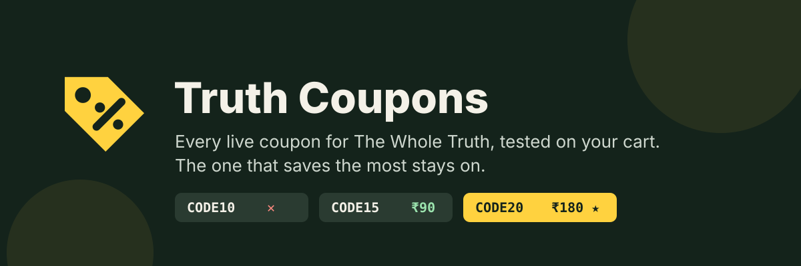
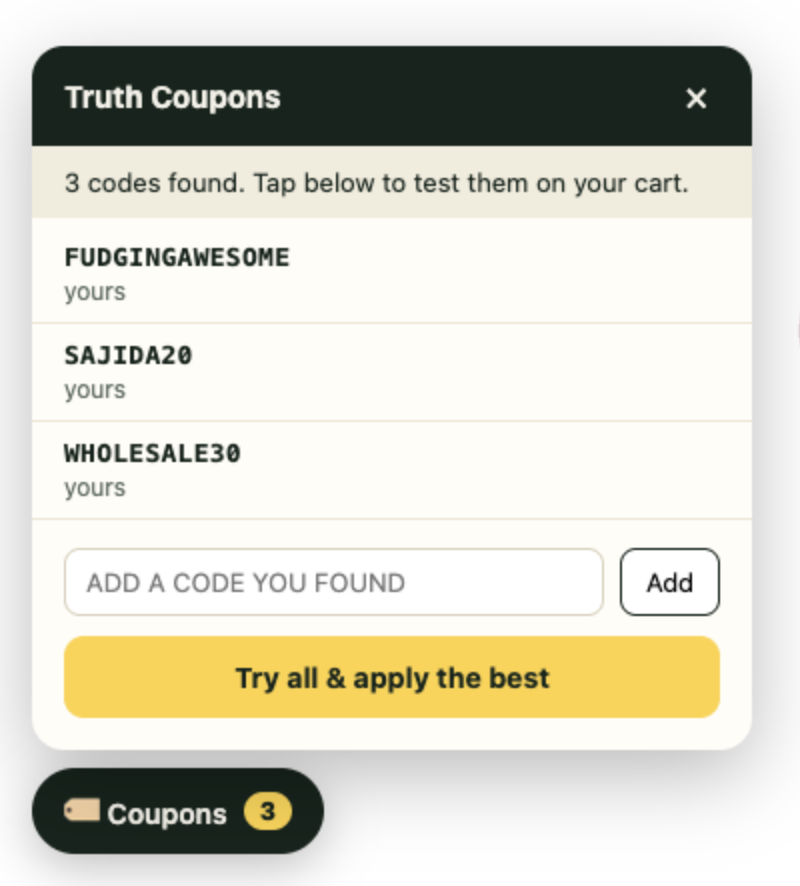
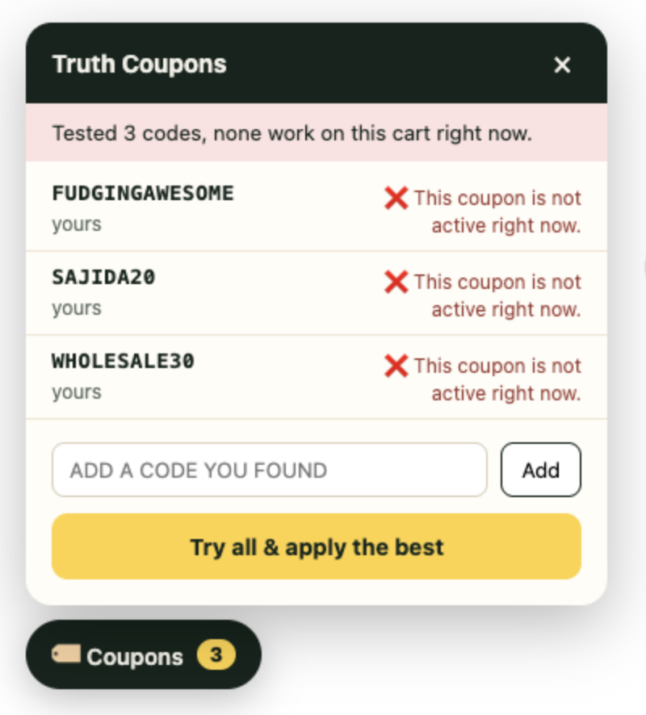
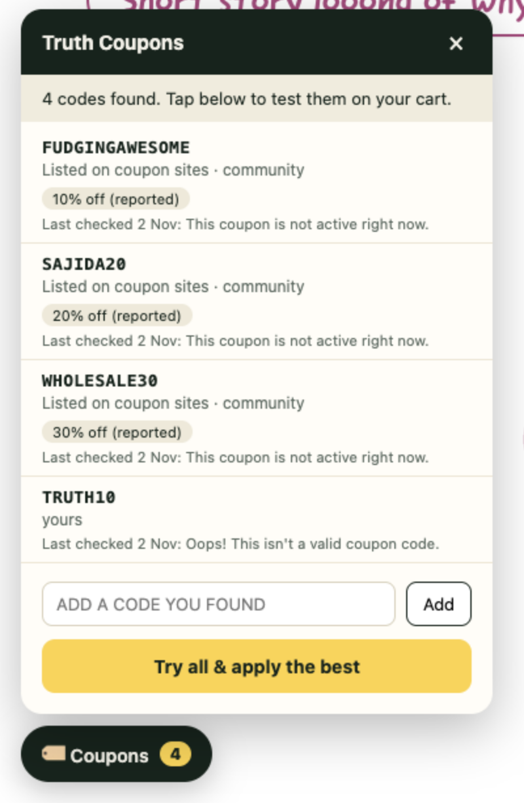
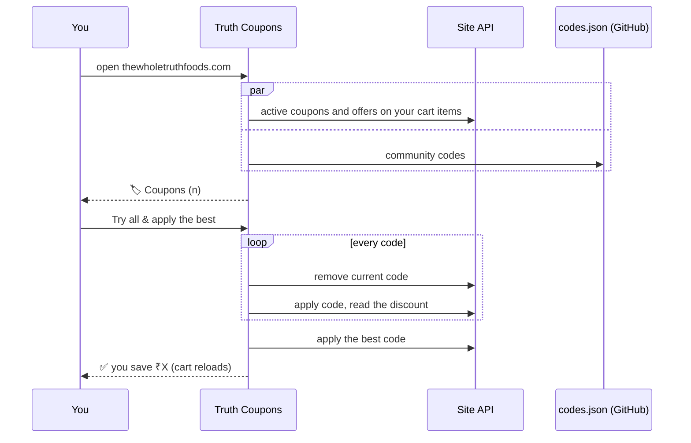

<p align="center"></p>

# Truth Coupons

A Chrome extension for [thewholetruthfoods.com](https://thewholetruthfoods.com). It collects every coupon code it can find, tests each one on your cart, and leaves the one that saves you the most applied. You don't have to search coupon sites or type codes in one by one.

> Unofficial. Not made by or affiliated with The Whole Truth Foods.

<p align="center">
  
  &nbsp;&nbsp;
  
</p>

## What it does

1. When you open the site, a **🏷️ Coupons** button appears in the bottom-left corner, with the number of codes found.
2. Click **Try all & apply the best**. The extension tests every code on your current cart, one at a time, and marks each one ✅ with the amount saved or ❌ with the reason the site gave.
3. Then it applies the code that saved the most and reloads the cart. If none of the codes work, any code you already had stays applied.


## What each code shows

The panel shows each code's conditions before you test it, so you can see why a code won't work on your cart:

<p align="center"></p>

| Shown as | Meaning |
| --- | --- |
| `Add ₹195 more to unlock` | Your cart is below the code's minimum order |
| `15% off` · `Flat ₹100 off` · `Buy 2, get 1 free` | What the code gives |
| `Min order ₹999` · `Min 3 items` | Minimum order value or item count (`on MRP` means it is counted on MRP, not the sale price) |
| `Only on Protein Bars` | Product-specific code. **Terms & eligible products** links to the store's own page listing the products it works on |
| `Prepaid orders only` · `Cash on delivery only` | Payment method the code needs |
| `New customers only` · `Once per customer` | Who can use the code, and how often |
| `Valid till 15 Dec 2026` | Expiry date |
| **Terms & eligible products** | The store's full T&C text for the code |
| `Last checked 2 Nov: …` | The last result this code got on your cart. It is kept in your browser, like the "last worked" note on coupon sites |

Conditions for the store's own codes come from the store. Conditions for community codes come from `codes.json`, and are only what the person who added them reported.

## Where the codes come from

| Source | What it is | Updated by |
| --- | --- | --- |
| **Site** | The store's own list of active coupons, plus any offers on the items in your cart | The Whole Truth |
| **Community** | [`codes.json`](codes.json) in this repo, fetched live every time you open the site | Anyone, by pull request |
| **Yours** | Codes you type into the panel, for example from an Instagram or YouTube creator | You (saved in your browser only) |

Codes listed on more than one source are only tested once.

## How it works



Each code is tested on a cart with no other code applied, because the site rejects a code when a bigger one is already applied. The extension sends the same requests the site's own coupon box sends, from your browser tab, so it can only apply codes the store itself accepts. It never generates or guesses codes.

## Install

The extension isn't on the Chrome Web Store, so load it from this repo:

1. `git clone https://github.com/ashusnapx/wholetruth-coupons.git`, or download the ZIP from the green **Code** button and unzip it.
2. Open `chrome://extensions` and turn on **Developer mode** (top-right corner).
3. Click **Load unpacked** and select the `wholetruth-coupons` folder.
4. Open [thewholetruthfoods.com](https://thewholetruthfoods.com), add something to your cart, and click **🏷️ Coupons**.

To update, run `git pull` (or download the ZIP again) and click the reload icon on the extension's card in `chrome://extensions`.

## Add a code for everyone

Found a code that works? Add it to [`codes.json`](codes.json) and open a pull request:

```json
{
  "code": "SOMECODE",
  "note": "Where you found it, e.g. a creator's reel",
  "terms": ["15% off", "Prepaid orders only"],
  "min": 999
}
```

`terms` and `min` are optional. `terms` are shown as chips under the code. `min` is the minimum order in rupees, and the extension uses it to show how much more the cart needs.

Everyone with the extension gets the new code the next time they open the site. GitHub can take up to 5 minutes to serve the updated file. Codes that stop working are fine to leave in for a while, because the extension tests every code anyway. Please remove a code once it has expired for good.

Codes are added by pull request, so someone reviews each one. Coupon sites that accepted codes from anyone have had to stop because of spam and fake codes.

## Privacy

- The extension only runs on `thewholetruthfoods.com`.
- It sends requests only to the store's own API, to apply and remove codes on your cart, and to `raw.githubusercontent.com`, to fetch `codes.json`.
- Codes you add, and the last result of each code, are saved in your browser's extension storage. They are never uploaded anywhere.
- There are no analytics, no tracking, and no account.

## Limits

- **Freebie codes** (codes that add a free product) are not tested yet. Only codes that take money off are.
- `Add ₹X more to unlock` is not shown for codes whose minimum is counted on MRP, because the cart doesn't report its MRP total.
- `Last checked` is only your own history. Other users' results aren't shared, because there is no server.
- If the store changes its API or rotates its public storefront key, the extension stops finding codes until it is updated here.
- If your cart is empty, there is nothing to test the codes on, so the extension asks you to add something first.

## Development

No build step. The files are loaded as they are:

| File | Purpose |
| --- | --- |
| [`manifest.json`](manifest.json) | Manifest V3. Content script only, plus the `storage` permission |
| [`content.js`](content.js) | Fetches the codes, tests them through the store's API, draws the panel in a shadow DOM |
| [`lib.js`](lib.js) | Pure helpers: merging code lists, picking the best result, turning the store's coupon rules into short terms |
| [`codes.json`](codes.json) | Community code list |
| [`test.js`](test.js) | `node test.js` |

After you edit a file, reload the extension in `chrome://extensions`, then refresh the site.
